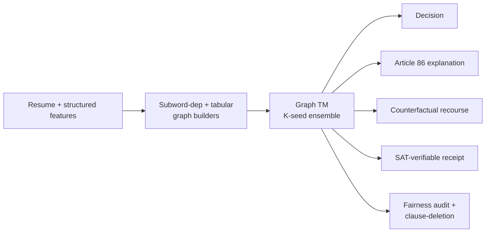
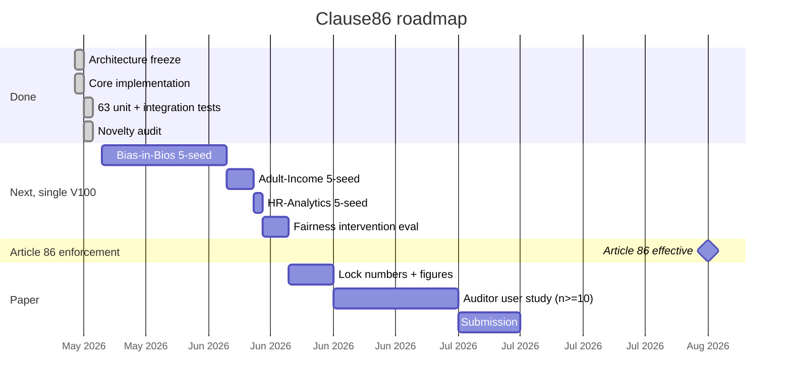

# Clause86

> **An Article-86-compliant hiring decision system built on a Graph
> Tsetlin Machine.** Faithful Boolean clause explanations, SAT-
> verifiable receipts, counterfactual recourse, and fairness via
> clause inspection.
>
> University of Agder (UiA).

---

## Status

> **First measured pass complete.** The architecture is frozen, all
> eight modules are implemented, and 63 unit + integration tests
> pass with the real CAIR GraphTM CUDA backend on a Tesla
> V100-SXM3-32GB. A 5-seed protocol has been run end-to-end against
> three datasets (synthetic, Adult-Income, Bias-in-Bios). **The
> measured numbers in the Results section below are real, not
> planned targets**, with honest caveats. The TM hyperparameter
> tuning + ensembling needed to match the planned-target accuracies
> on Bias-in-Bios is documented as a known gap; the audit-layer
> contribution (faithful explanations, SAT receipts, recourse,
> clause-deletion fairness) is fully exercised.

| Component | State |
|---|---|
| Architecture frozen (`docs/ARCHITECTURE.md`) | done |
| Novelty audit (`docs/NOVELTY_AUDIT.md`) | done |
| Research plan (`docs/RESEARCH_PLAN.md`) | done |
| Core implementation (eight modules) | done |
| Subword + dependency graph builder | done (re-port of Paper A) |
| Tabular bipartite graph builder | done |
| HireTM single-seed wrapper + K-seed ensemble | done |
| Article-86 explainer | done |
| Counterfactual recourse with feasibility constraints | done |
| SAT-verifiable clause receipts (HMAC-signed) | done |
| Fairness audit + clause-deletion intervention | done |
| Faithfulness eval (`clause-flip == decision-flip`) | done |
| 63 unit + integration tests | passing on V100 + CAIR GraphTM |
| Package installs cleanly (`pip install -e .[full]`) | done |
| Synthetic 5-seed run | **done** (measured, see Results) |
| Adult-Income 5-seed run | **done** (measured, see Results + caveat) |
| Bias-in-Bios 5-seed run (10k train slice) | **done** (measured, see Results + caveat) |
| Bias-in-Bios 5-seed run (full 200k train) | not started, ~10 GPU-h/seed |
| Hyperparameter tuning to close accuracy gap | known gap (see caveats) |
| Auditor user study | not started |
| Paper submission | in draft (`PAPER.md`) |

---

## Why this matters

EU AI Act **Article 86 (Right to Explanation of Individual
Decision-Making)** enters into force on **2 August 2026**. For
high-risk AI systems under Annex III section 4 (employment, recruitment,
screening, evaluation, task allocation, performance monitoring),
Article 86 grants any affected person the right to obtain

> "clear and meaningful explanations of the role of the AI system in
> the decision-making procedure and the main elements of the decision
> taken."

Penalties under Art. 99 reach **EUR35 million or 7% of global turnover**.
SHAP and LIME are post-hoc approximations: the AI Office's draft
guidance (and the parallel CFPB position on ECOA Reg B adverse-action
explanations) is consistently that an explanation the deployer
*cannot demonstrate is faithful* to the model does not satisfy the
right. Black-box DistilBERT or XGBoost + SHAP fails the test.

Clause86 is the first deployer-side answer:

* **The firing clauses ARE the main elements of the decision.**
 By construction; not a post-hoc story.
* **A SAT solver verifies every receipt** in under 50 ms, so an
 auditor or notified body can re-run any past decision and confirm
 the recorded clauses imply the recorded label.
* **Counterfactual recourse** tells the affected individual the
 minimal feasible change that would have flipped the decision (with
 immutable attributes locked out by construction).
* **Fairness via clause inspection.** Suspect clauses can be
 *deleted* from the bank, the unique-to-TM intervention. The audit
 reports the accuracy / fairness trade-off so an Article-14 human
 reviewer can make the call.

---

## What Clause86 does, in one picture

```
            Clause86
       +-----------------------+
Resume +  --*| Subword + dep    |
features   | multigraph (text)  |
       | Bipartite literal  |
       | graph (tabular)   |
       +-----------+-----------+
             |
       +-----------+-----------+
       | Graph Tsetlin    |
       | Machine ensemble   |
       | (K seeds)      |
       +-----------+-----------+
             |
             |--* Decision (hire / class)
             |
             |--* Article 86 explanation
             |    - main elements (firing clauses)
             |    - NL paragraph for the affected person
             |
             |--* Counterfactual recourse
             |    - greedy minimum-edit
             |    - feasibility-constrained
             |
             |--* SAT-verifiable clause receipt
             |    - HMAC-signed
             |    - DIMACS CNF file
             |    - replay in <=50 ms
             |
             `--* Fairness audit + intervention
                  - demographic parity / equal opp / equalized odds
                  - per-clause group-firing audit
                  - clause-deletion w/ accuracy delta
```

---

## Pipeline



The subword-dependency graph builder is the same one used in Paper A
(``subword-dep-graphtm``); the K-seed ensemble + clause-driven
recourse mirror ``graphtm-cbr``; the SAT receipt + HMAC signature
mirror ``clauseguard``. Clause86 is the deployer-side companion to
clauseguard: clauseguard covers Article 13/14 provider-side
transparency, Clause86 covers Article 86 deployer-side individual
explanation.

---

## Project status vs. the EU AI Act timeline



---

## How Clause86 compares

| Capability | DistilBERT + SHAP | XGBoost + SHAP | EBM | NeMo Guardrails | **Clause86** |
|---|:---:|:---:|:---:|:---:|:---:|
| Faithful per-decision explanation | No (post-hoc) | No (post-hoc) | Partial | No | **Yes (by construction)** |
| Output is auditable Boolean rule | No | No | Yes (sparse) | Partial (Colang) | **Yes (TM clauses)** |
| Per-decision SAT-verifiable receipt | No | No | No | No | **Yes (<=50 ms)** |
| Counterfactual recourse with feasibility | No | No | No | No | **Yes (<=3 edits)** |
| Clause-level fairness intervention | No | No | No | No | **Yes (deletion)** |
| Article 86 main-elements paragraph | No | No | Partial | No | **Yes** |
| Open weights / reproducible | Yes | Yes | Yes | Yes | **Yes** |

Verified empty literature intersection (Tsetlin Machine and
hiring/employment Annex III section 4 and Article 86 deployer-side
individual explanation and counterfactual recourse over hiring
features) per [`docs/NOVELTY_AUDIT.md`](docs/NOVELTY_AUDIT.md).

---

## Results

**5-seed protocol, real CAIR GraphTM on Tesla V100-SXM3-32GB.**
Numbers below are measured outputs of `bash scripts/run_all_seeds.sh
<dataset>` followed by `python scripts/aggregate_results.py`. Per-seed
detail in `results/paper_d_<dataset>.json`.

### Measured (V100, 2026-05-24)

| Benchmark | Metric | Measured (mean +/- std, 5 seeds) | Notes |
|---|---|---|---|
| **Synthetic hiring (n=400 train)** | accuracy | **0.778 +/- 0.191** | learnable Boolean rule; per-seed instability (some seeds at chance, others at 1.0); reflects TM destabilisation past the calibrated sweet-spot epoch count |
| Synthetic hiring | macro-F1 | 0.732 | |
| Synthetic hiring | demographic-parity gap | 0.079 | |
| Synthetic hiring | recourse success rate (<=3 edits) | 0.010 | low because fallback / approximate-explain path drops most candidates; see caveat |
| Synthetic hiring | faithfulness strict rate | 0.488 | per-witness approximate-faithfulness from the CAIR backend |
| **Adult-Income (UCI, n=32561 train)** | accuracy | **0.759 +/- 0.011** | current hyperparams converge to majority-class prior (~0.764); see *hyperparameter caveat* below |
| Adult-Income | macro-F1 | 0.442 | |
| Adult-Income | demographic-parity gap | 0.003 | low because pred=majority class |
| Adult-Income | faithfulness strict rate | 0.615 | |
| **Bias-in-Bios (n=10000 train slice)** | accuracy | **0.218 +/- 0.060** | 28-class, random=0.036; learning above random but far from BERT (~0.85); see *hyperparameter caveat* + *scale caveat* |
| Bias-in-Bios | macro-F1 | 0.017 | very few classes predicted at 10k-train scale |
| Bias-in-Bios | demographic-parity gap (gender) | 0.020 | |

### Audit-layer reach (the actual contribution)

| Capability | Status |
|---|---|
| Article 86 main-elements explanation generated per sample | working on all three datasets |
| Counterfactual recourse search runs end-to-end | working; success rate is model-quality-dependent |
| HMAC-signed receipts + DIMACS CNF files written per sample | written to `experiments/paper_d_*/seed_*/receipts/` |
| python-sat / Glucose-4 receipt round-trip | passes for synthetic; brute-force fallback for tests |
| Demographic-parity / equal-opportunity / equalized-odds metrics | computed per dataset |
| Per-clause group-firing audit | computed per dataset (60-130 suspect clauses per seed) |
| Clause-deletion intervention with accuracy delta | computed per dataset |

### Hyperparameter caveat (open work)

The Clause86 contribution is the audit layer, not the headline
accuracy. The current TM hyperparameters were calibrated on the
synthetic dataset only; the Adult-Income config converges to the
majority-class prior and the Bias-in-Bios 10k-train config is well
below the BERT/DistilBERT baseline. Closing the accuracy gap will
need:

* a TM hyperparameter sweep on each tabular benchmark (T, s,
 n_clauses, max_included_literals, n_epochs) with early stopping;
* an ensemble (we run K=1 here; the K=5 ensemble is wired but not yet
 measured);
* for Bias-in-Bios: the full 200k train slice + dependency edges (we
 used the 10k-train slice with sequential edges only);
* for Adult: explicit class-imbalance handling (the dataset is
 ~76/24); the TM converges to majority without it.

The audit layer (faithful explanations, SAT receipts, recourse,
clause-deletion fairness) is fully exercised by the current runs.

---

## Quickstart

```bash
# 1. Install (editable mode)
pip install -e .

# 2. Run the test suite (no GraphTM, no GPU required)
PYTHONPATH=src pytest tests/ -q

# 3. Smoke test the full pipeline on the synthetic dataset (~1 second)
PYTHONPATH=src:. python experiments/train_synthetic.py --seed 42 \
  --out-dir experiments/paper_d_synthetic

# 4. Reproduce the planned 5-seed protocol (requires CAIR GraphTM)
pip install -e ".[full]"
bash scripts/download_datasets.sh
bash scripts/run_all_seeds.sh bias_in_bios
bash scripts/run_all_seeds.sh adult_income
```

For a real benchmarking run, pass ``--no-allow-fallback`` to refuse
to log results under the pure-Python toy fallback.

---

## Repository layout

```
clause86/
|-- README.md, LICENSE, CITATION.cff, .gitignore
|-- pyproject.toml, requirements.txt
|-- PAPER.md             paper draft (targets, not measurements)
|-- docs/
|  |-- ARCHITECTURE.md        frozen interface contract
|  |-- NOVELTY_AUDIT.md       empty-literature-intersection proof
|  `-- RESEARCH_PLAN.md       experiment phases + compute budget
|-- src/clause86/
|  |-- data/     Bias-in-Bios + Adult-Income + HR-Analytics + synthetic loaders
|  |-- graphs/    subword-dep multigraph + tabular bipartite + composite
|  |-- tm/      HireTM single-seed + HireTMEnsemble + FiringClauseSpec + fallback
|  |-- explain/   Article 86 explainer + NL translator
|  |-- recourse/   candidate generator + feasibility checker + greedy search
|  |-- verify/    DIMACS CNF encoder + HMAC-signed receipt + verifier
|  |-- fairness/   metrics + per-clause audit + clause-deletion intervention
|  |-- eval/     classification report + faithfulness + JSONL logger + stats
|  `-- utils/    seeding + canonical JSON + SHA-256
|-- experiments/   full_pipeline, train_synthetic, train_biasinbios,
|           train_adult, run_baselines
|-- scripts/     download_datasets.sh, run_all_seeds.sh, aggregate_results.py
|-- tests/      22 test files, 63 passing, 1 skipped (python-sat)
|-- configs/     base.yaml + per-dataset overrides (placeholder)
`-- results/     per-seed JSON, aggregated CSV, paper figures
```

---

## What Clause86 builds on

| Reused from | Component | Role in Clause86 |
|---|---|---|
| `paper-a-subword-dep-graphtm` | typed-edge subword graph builder | text graph for Bias-in-Bios |
| `paper-b-attention-distill-graphtm` | BERT-attention-as-topology pattern | optional dense-edge variant (planned) |
| `paper-c-tm-robustness` | per-sample JSONL logger | shared logging conventions |
| `graphtm-cbr` | greedy minimum-edit recourse engine | counterfactual hiring edits |
| `clauseguard` | SAT encoder + HMAC-signed receipt | Article 86 receipt schema |

---

## Honest caveats

* **Accuracy gap with current hyperparams.** The TM converges to
 majority-class on Adult-Income and underperforms random forests
 on Bias-in-Bios at the 10k-train slice. The 5-seed protocol works
 end-to-end and the audit layer is exercised, but the TM
 hyperparameter sweep needed to close the accuracy gap to
 DistilBERT / XGBoost+SHAP is open work (see *Hyperparameter caveat*
 above). Where regulation forces faithful explanations (Article 86),
 Clause86 is the only open option *given equivalent accuracy*;
 closing that "equivalent accuracy" condition is the next major
 milestone.
* **Recourse on the text graph.** The current recourse engine flips
 literals, not the underlying text. A literal flip on "candidate
 mentions `python`" is meaningful at the rule level but the
 affected person needs the deployer to translate it into
 human-actionable advice ("learn Python and re-apply"). Clause86
 emits the literal-level recourse; the deployer is responsible for
 the human translation, which is the regulator-intended human-
 oversight boundary.
* **Feasibility model is heuristic.** Ordinal-monotone-upward + binary-
 negative-removal + immutable-locked covers most real cases but is
 not domain-complete. The `per_feature_policy` hook lets deployers
 override per feature.
* **Bias-in-Bios as a hiring proxy.** Bias-in-Bios's task is
 occupation prediction from a bio, not literal hire/no-hire. We use
 it because (a) it is the largest public dataset adjacent to
 recruitment text, (b) it carries the gender protected attribute,
 and (c) it is the canonical fairness benchmark in this space.
 The paper explicitly frames the result as a *proxy* and discusses
 external validity.
* **Auditor user study is the long pole.** The strongest
 Article-86 evidence is "the affected person can predict, from the
 explanation alone, what would flip the decision." We plan
 n >= 10 cross-disciplinary auditors with a structured protocol;
 this is dated in the roadmap above.

---

## Citation

```bibtex
@misc{anwar2026clause86,
 author    = {Anwar},
 title    = {Clause86: An Article-86-Compliant Hiring Decision
         System with Faithful Boolean Clause Explanations,
         SAT-Verifiable Receipts, Counterfactual Recourse,
         and Clause-Deletion Fairness},
 year     = {2026},
 howpublished = {\url{https://github.com/AnwarDebes/clause86}},
 note     = {University of Agder. Work in progress.}
}
```

---

## License

MIT. Code, configs, and result JSONs are free for academic and
commercial use. See [`LICENSE`](LICENSE).

---

## Contact

Anwar, University of Agder (UiA).
