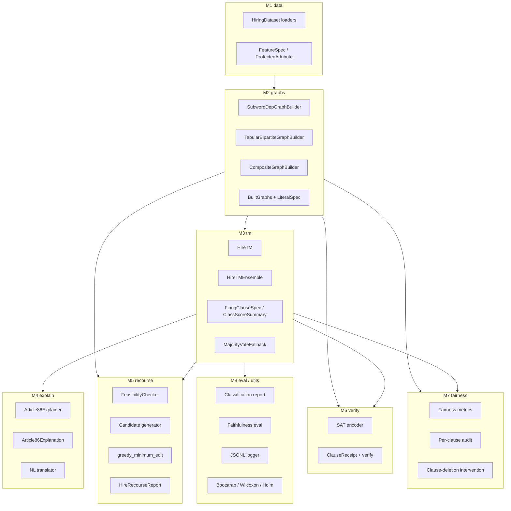

# Architecture (frozen interface contract)

This document is the **load-bearing interface contract** for Clause86.
Code lives in eight modules under `src/clause86/`; each module owns
its public API and is tested independently. The interfaces below are
the ones every other module depends on. Changes to these signatures
require updating this document and re-running the full test suite.



## Invariants (enforced by tests)

I1. **HiringDataset is schema-consistent.** Every key in every record
  dict must appear in `schema`. Enforced by
  `HiringDataset.__post_init__`; checked by
  `tests/test_data/test_synthetic.py`.

I2. **LiteralSpec.immutable is honoured by recourse.** The recourse
  module must NEVER propose flips of immutable literals. Checked
  by `tests/test_recourse/test_feasibility.py` and
  `tests/test_integration/test_explain_recourse_consistency.py`.

I3. **HireTM backend selection is explicit.** A real TM kernel
  (`GraphTsetlinMachine` or `tmu`) is preferred; the pure-Python
  fallback is enabled by default (`allow_fallback=True`) for tests
  and disabled (`allow_fallback=False`) in benchmarking scripts.
  A `BackendUnavailableError` is raised when neither path applies.
  Checked by `tests/test_tm/test_fallback.py`.

I4. **Clause-flip / decision-flip faithfulness is verifiable.** For
  any TM-backed `HireTM`, applying a faithfulness-witness flip
  must produce a margin change consistent with the witness's
  sign. Verified at run-time by
  `clause86.eval.faithfulness.check_faithfulness`; reported on
  the JSONL log.

I5. **Receipt round-trip is bit-stable.** A `ClauseReceipt` built
  with `build_receipt(...)` and re-verified with
  `verify_receipt(...)` must return `all_ok=True` provided no
  field has been mutated. Tampering with any field other than
  `signature_hex` must invalidate the signature. Checked by
  `tests/test_verify/test_receipt.py`.

I6. **No silent CPU fallback when a real TM is requested.** The
  `HireTM(allow_fallback=False)` constructor refuses to silently
  downgrade. Checked by `tests/test_tm/test_fallback.py`.

I7. **Reproducibility.** All seeds are explicit; no module-level
  `np.random.seed(...)`. `utils.seed_everything(seed)` is the only
  sanctioned RNG seeding entry point.

---

## Module signatures

### M1, `clause86.data`

```python
class FeatureKind(str, Enum):
  TEXT, CATEGORICAL, ORDINAL, BINARY, IMMUTABLE

class ProtectedAttribute(str, Enum):
  GENDER, RACE, AGE_GROUP, NATIONALITY, DISABILITY

@dataclass(frozen=True)
class FeatureSpec:
  name: str
  kind: FeatureKind
  n_buckets: int = 0
  categories: tuple[str, ...] = ()
  nl_template: str = "{name} = {value}"

@dataclass
class HiringDataset:
  name: str
  records: list[dict[str, Any]]
  labels: list[int]
  class_names: list[str]
  schema: list[FeatureSpec]
  protected: list[dict[ProtectedAttribute, str]]
  split: list[str]
  meta: dict[str, Any]
  def split_indices(self, tag: str) -> list[int]
  def select(self, indices: list[int]) -> "HiringDataset"
  @property
  def n_classes(self) -> int

def load_synthetic_hiring(...) -> HiringDataset
def load_bias_in_bios(...) -> HiringDataset
def load_adult_income(...) -> HiringDataset
def load_hr_analytics(...) -> HiringDataset
```

### M2, `clause86.graphs`

```python
@dataclass(frozen=True)
class LiteralSpec:
  literal_id: int
  feature_name: str
  bucket_or_category: str
  feature_kind: str
  nl_template: str
  immutable: bool = False

@dataclass
class BuiltGraphs:
  graphs: Any
  n_samples: int
  symbols: list[str]
  edge_types: list[str]
  literal_specs: list[LiteralSpec]
  per_sample_active_literals: list[tuple[int, ...]]
  meta: dict[str, Any]
  @property
  def n_literals(self) -> int
  def get_active_literal_vector(self, sample_idx: int) -> list[int]

class SubwordDepGraphBuilder:
  def fit(self, texts: list[str]) -> None
  def transform(self, texts: list[str], *, graph_backend: str = "auto") -> BuiltGraphs

class TabularBipartiteGraphBuilder:
  schema: list[FeatureSpec]
  add_self_loop: bool
  ordinal_thresholds: dict[str, list[float]]
  def fit(self, records: Iterable[dict]) -> None
  def transform(self, records: list[dict], *, graph_backend: str = "auto") -> BuiltGraphs

class CompositeGraphBuilder:
  def fit(self, dataset: HiringDataset) -> None
  def transform(self, dataset: HiringDataset, *, graph_backend: str = "auto") -> BuiltGraphs
```

### M3, `clause86.tm`

```python
@dataclass(frozen=True)
class FiringClauseSpec:
  clause_id: int
  class_id: int
  polarity: int
  weight: int
  positive_literal_ids: tuple[int, ...]
  negative_literal_ids: tuple[int, ...]
  member_id: int | None

@dataclass(frozen=True)
class ClassScoreSummary:
  scores: tuple[int, ...]
  argmax_label: int
  margin: int
  firing_clauses: tuple[FiringClauseSpec, ...]

class HireTM:
  def fit(self, train_built: BuiltGraphs, train_labels: list[int], *, n_epochs: int, n_classes: int | None) -> "HireTM"
  def predict(self, built: BuiltGraphs) -> list[int]
  def explain(self, built: BuiltGraphs, sample_idx: int) -> ClassScoreSummary

class HireTMEnsemble:
  seeds: tuple[int, ...]
  # same fit/predict/explain signature as HireTM

class BackendUnavailableError(RuntimeError): ...
```

### M4, `clause86.explain`

```python
@dataclass
class Article86Explanation:
  sample_idx: int
  deployer_name: str
  predicted_class: int
  predicted_class_name: str
  class_scores: tuple[int, ...]
  margin: int
  n_firing_clauses: int
  main_elements: list[dict[str, Any]]
  counter_elements: list[dict[str, Any]]
  disclosure: str
  def render_nl(self, max_elements: int = 5) -> str
  def faithfulness_witness(self, literal_specs: list[LiteralSpec], literal_vector: list[int]) -> list[dict[str, Any]]
  def to_dict(self) -> dict[str, Any]

@dataclass
class Article86Explainer:
  class_names: list[str]
  deployer_name: str
  top_k_main_elements: int = 10
  top_k_counter_elements: int = 5
  def explain(self, summary: ClassScoreSummary, built: BuiltGraphs, sample_idx: int) -> Article86Explanation
```

### M5, `clause86.recourse`

```python
@dataclass(frozen=True)
class RecourseEdit:
  literal_id: int
  from_value: int
  to_value: int
  rationale: str
  utility_prior: float

@dataclass
class HireRecourseReport:
  sample_idx: int
  adverse_class_id: int
  target_class_id: int
  applied_edits: list[RecourseEdit]
  score_history: list[tuple[int, ...]]
  margin_history: list[int]
  final_prediction: int
  success: bool
  total_latency_ms: float
  candidates_examined: int
  notes: list[str]

@dataclass
class FeasibilityChecker:
  literal_specs: list[LiteralSpec]
  per_feature_policy: Mapping[str, Callable[[LiteralSpec, int, int], bool]]
  def may_flip(self, literal_id: int, *, from_v: int, to_v: int) -> bool

def generate_candidates(
  *, sample_idx: int, built: BuiltGraphs,
  firing_clauses: list[FiringClauseSpec],
  adverse_class_id: int, target_class_id: int,
  feasibility: FeasibilityChecker | None,
  all_clauses_for_target: list[FiringClauseSpec] | None,
) -> list[RecourseEdit]

def greedy_minimum_edit(
  *, built: BuiltGraphs, sample_idx: int,
  initial_summary: ClassScoreSummary, target_class_id: int,
  explain_fn: Callable[[BuiltGraphs, int], ClassScoreSummary],
  all_target_clauses: list[FiringClauseSpec] | None = None,
  feasibility: FeasibilityChecker | None = None,
  max_edits: int = 3, time_budget_ms: float = 5000.0,
  max_candidates_per_step: int = 32,
) -> HireRecourseReport
```

### M6, `clause86.verify`

```python
@dataclass(frozen=True)
class FiringClauseForSAT:
  clause_id: int
  class_id: int
  polarity: int
  weight: int
  positive_literal_ids: tuple[int, ...]
  negative_literal_ids: tuple[int, ...]
  def variable_offset(self, n_literals: int) -> int

def encode_clauses_to_dimacs(
  *, literal_vector: list[int],
  firing_clauses: list[FiringClauseForSAT],
  n_literals: int | None = None,
) -> tuple[list[list[int]], int]

def write_dimacs_file(cnf, n_vars, out_path, *, comments: list[str] | None = None) -> None
def solve_cnf(cnf, n_vars) -> tuple[bool, list[int] | None]

@dataclass
class ClauseReceipt:
  # ... see receipt.py
  signature_hex: str
  def signing_payload(self) -> bytes

@dataclass
class ReceiptVerification:
  signature_ok: bool
  sat_consistent: bool
  arithmetic_ok: bool
  notes: list[str]
  @property
  def all_ok(self) -> bool

def build_receipt(
  *, sample_id: str, dataset_name: str, model_version: str,
  deployer_name: str, issued_at_utc: str,
  literal_vector: list[int],
  firing_clauses: list[FiringClauseForSAT],
  class_scores: list[int], predicted_class: int, margin: int,
  class_names: list[str], cnf_dir: str | Path,
  recourse_dict: dict[str, Any] | None = None,
  hmac_key: bytes | None = None,
) -> ClauseReceipt

def verify_receipt(receipt: ClauseReceipt, *,
          expected_predicted_class: int | None = None,
          hmac_key: bytes | None = None) -> ReceiptVerification
```

### M7, `clause86.fairness`

```python
@dataclass
class FairnessMetrics:
  attribute: ProtectedAttribute
  favourable_class_id: int
  n_total: int
  per_group: dict[str, dict[str, float]]
  demographic_parity_gap: float
  equal_opportunity_gap: float
  equalized_odds_gap: float
  def to_dict(self) -> dict[str, Any]

def compute_fairness_metrics(
  predictions: list[int], labels: list[int],
  protected: list[dict[ProtectedAttribute, str]],
  attribute: ProtectedAttribute,
  favourable_class_id: int = 1,
) -> FairnessMetrics

@dataclass
class ClauseFairnessAudit:
  attribute: ProtectedAttribute
  n_total: int
  per_clause: dict[int, dict[str, float]]
  suspect_clause_ids: list[int]
  suspect_threshold: float
  def to_dict(self) -> dict[str, Any]

def audit_clauses(*, clauses, built, protected, attribute, suspect_threshold) -> ClauseFairnessAudit

@dataclass
class DeleteClausesResult:
  deleted_clause_ids: list[int]
  before_predictions: list[int]
  after_predictions: list[int]
  accuracy_before: float
  accuracy_after: float
  fairness_before: dict[str, float] | None
  fairness_after: dict[str, float] | None
  notes: list[str]

def apply_clause_deletion(*, summaries, labels, protected, attribute,
             deleted_clause_ids, favourable_class_id, n_classes) -> DeleteClausesResult
```

### M8, `clause86.eval` and `clause86.utils`

```python
@dataclass
class ClassificationReport:
  accuracy: float
  macro_f1: float
  n: int
  per_class: dict[int, dict[str, float]]

def classification_report(y_true, y_pred, n_classes=None) -> ClassificationReport
def accuracy_score(y_true, y_pred) -> float
def macro_f1_score(y_true, y_pred, n_classes=None) -> float

@dataclass
class FaithfulnessResult:
  sample_idx: int
  n_witnesses: int
  n_strictly_correct: int
  n_decision_flipped: int
  mean_magnitude_error: float
  per_witness: list[dict[str, Any]]
  @property
  def strict_score(self) -> float

def check_faithfulness(*, built, sample_idx, baseline_summary, witnesses, explain_fn) -> FaithfulnessResult

class JsonlLogger:
  def __init__(self, path, *, seed: int | None = None, run_id: str | None = None)
  def log(self, stage: str, payload: dict) -> None
  def close(self) -> None

def paired_bootstrap_ci(deltas, *, n_resamples=10000, confidence=0.95, seed=42) -> tuple[float, float, float]
def wilcoxon_signed_rank(a, b) -> dict[str, float]
def holm_bonferroni(p_values: list[float], alpha: float = 0.05) -> list[bool]

def seed_everything(seed: int) -> None
def canonical_json(obj) -> bytes
def sha256_of(obj) -> str
def write_jsonl(path, rows) -> int
def read_jsonl(path) -> Iterator[dict]
```

---

## Data flow contracts

C1. **`BuiltGraphs` is the wire format between graph builders and
  every downstream module.** No module other than M2 may construct
  a `BuiltGraphs`. All downstream modules read literal indexes
  from `built.literal_specs` and active sets from
  `built.per_sample_active_literals`.

C2. **`ClassScoreSummary` is the wire format between TM and every
  explain / recourse / verify call.** It carries the firing
  clauses, the per-class scores, and the predicted class. Every
  explain / recourse / verify operation operates on it; the TM
  backend is never re-introspected after the summary is built.

C3. **`FiringClauseSpec` and `FiringClauseForSAT` are the same
  information at two boundaries.** The SAT encoder's
  `FiringClauseForSAT` is a deliberate strict subset of
  `FiringClauseSpec` (it drops `member_id` because the SAT
  receipt does not depend on which ensemble member produced the
  clause). Both modules MUST be edited together if the field set
  grows.

C4. **Per-sample logs are append-only and JSON-stable.** Every
  pipeline stage writes one JSONL record per sample. A canonical-
  JSON encoding (`utils.io.canonical_json`) is used for any field
  covered by a hash or HMAC.

C5. **Article 86 explanation is a function of the
  `ClassScoreSummary`, never of the TM weights.** The explainer
  has no access to TA states; everything an auditor needs is in
  the firing clauses already.
